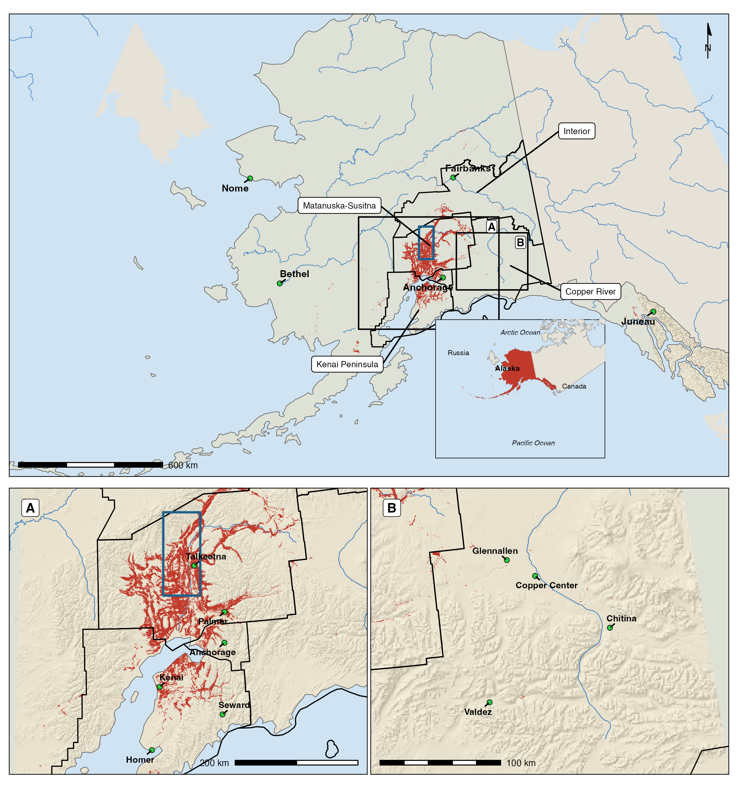
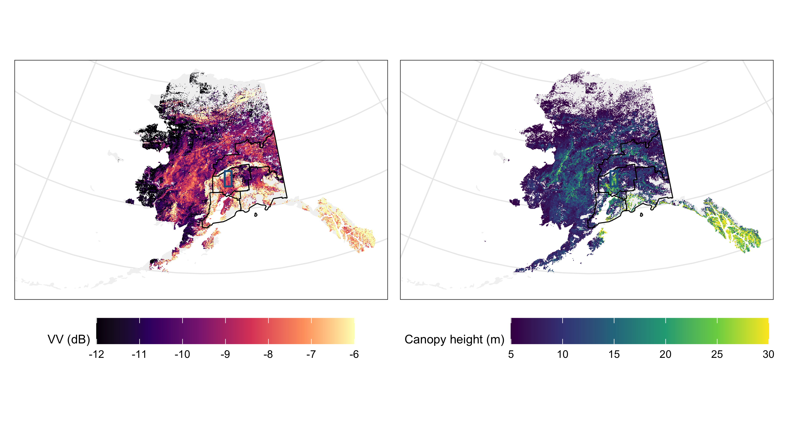
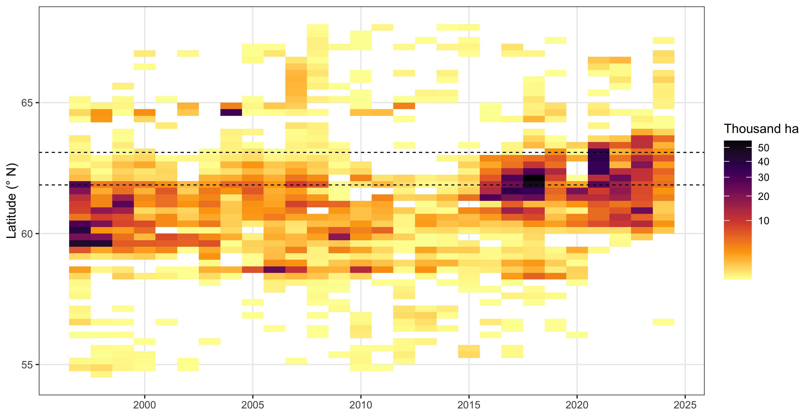

# A spruce beetle susceptibility map of Alaska using Sentinel-1 radar and crown-scale mortality data

Manuscript prepared for submission to Forestry, An International Journal of Forest Research. The text, tables and figures below are read from the rendered manuscript of 2026-10-19, so they match it word for word and number for number.

## Abstract

Outbreaks of the spruce beetle (*Dendroctonus rufipennis* (Kirby)) in Alaska have killed the largest spruce first, so the tallest stands are most at risk in the next outbreak. Managers rate that hazard from tree diameter, basal area, and spruce share measured on the ground, which no cruise covers statewide, and no study had tested whether radar measures of stand structure pick out the stands an outbreak kills. This study scored Sentinel-1 radar backscatter of 2014 to 2016, before the current outbreak reached the Susitna valley, and a canopy height map against a crown-scale map of the spruce killed there by 2021 (41 764 cells of 90 m), then pooled every scene over Alaska into a 90 m map of pre-outbreak backscatter tested against the aerial detection survey. The killed stands had returned more backscatter before the outbreak and were taller, 24.7 m against 12.9 m. At the threshold that best separated the two, the backscatter map classed 91 per cent of the killed and 76 per cent of the spared stands correctly, an overall accuracy of 89 per cent. On the Kenai Peninsula and in the Matanuska-Susitna Borough it marked 77 and 80 per cent of the attacked forest as susceptible and 44 and 48 per cent of the unattacked, respectively. In the Copper River basin, where attacked stands were 13.6 m tall against 10.4 m, it marked less than 1 per cent of either and only canopy height separated them. Backscatter and canopy height therefore marked the stands the beetle killed with no beetle data and no cruise in the spruce forest of Southcentral Alaska, but not in its open woodland. Of Alaska’s 906 521 km² of forest, 29 per cent lay at or above the threshold, so the map shows managers which stands to protect first.

## Figures

**Figure 1.** The study area. Main map, Alaska in the Alaska Albers projection (EPSG:3338) over a shaded relief, with the spruce beetle damage mapped by the aerial detection survey from 2016 to 2024 in red, the four regions in which the statewide map was tested outlined in black, the validation strip of the Susitna valley in which Zwieback et al. (2024) mapped dead spruce crowns on a WorldView-2 image of 2 August 2021 framed in blue, and the two detail panels boxed. A, Cook Inlet, the Kenai Peninsula and the Susitna valley. B, the Copper River basin. The inset places Alaska in North America.

**Figure 2.** The statewide susceptibility map at 1 km, the mean of the 90 m product over the forest cells of each 1 km cell. Left, the slope-corrected Sentinel-1 VV level of October 2014 to December 2016 brought to a 38 degree incidence angle; right, the ETH canopy height of 2020. Cells with less than a fifth of their area in forest are blank. Black outlines are the four test regions and the blue frame the validation strip.

## Tables

**Table 1.** The measures the study entered, the attribute of the hazard ratings each stands for, the direction expected in the stands an outbreak killed, and the literature the expectation rests on.

| Measure | Stands for | Expected in killed stands | Basis |
|---|---|---|---|
| Canopy height before the outbreak, from three sources | Large dominant spruce | Taller | The beetle takes large, slowly growing dominants and codominants first (Massey and Wygant 1954, Werner and Holsten 1983, Hard and Holsten 1985, Doak 2004), and an outbreak left stands with smaller average and maximum heights (Veblen et al. 1991) |
| Sentinel-1 C-band VV level before the outbreak | Stand structure and biomass | Higher | Backscatter rises with forest biomass until it saturates, C-band being much less sensitive than L-band (Dobson et al. 1992, Santoro and Cartus 2018) |
| ALOS PALSAR L-band HV level | Stand structure and biomass | Higher | Backscatter rises with biomass to a saturation near 100 tons per hectare at L-band (Dobson et al. 1992) |
| Change in VV through the outbreak | Mortality | A difference of either sign, if the radar recorded the mortality | Radar was proposed for bark beetle damage, although detection before the crowns fade has had limited success (Hollaus and Vreugdenhil 2019, Hechtl et al. 2025) |
| Diameter and height of dead and live white spruce on inventory plots | Tree size | Dead trees larger and taller where the outbreak has run | Killed trees were larger and grew more slowly than survivors in the same stands (Werner and Holsten 1983, Hard 1985, Doak 2004) |
| Year the survey first recorded a stand | Order of attack | Taller stands recorded earlier | The largest trees died first and smaller ones as the outbreak proceeded (Massey and Wygant 1954, Schmid and Frye 1976, Werner and Holsten 1983) |

**Table 2.** Area under the receiver operating characteristic curve for ranking the stands the outbreak killed above the living stands, by source and by label. The crown labels are the 90 m stand cells of the Zwieback et al. (2024) training areas, the severity map their 90 m map of 2021, and the survey the aerial detection survey polygons of 2016 to 2024 across the rest of the Matanuska-Susitna Borough. The statewide product is the pooled, angle-corrected VV level of every scene; the two orbits are the single-orbit levels of the same months.

| Source | Crown labels | Severity map | Survey, Matanuska-Susitna |
|---|---|---|---|
| Sentinel-1 VV, statewide product |  | 0.86 |  |
| Sentinel-1 VV, ascending orbit 65 | 0.89 | 0.88 | 0.63 |
| Sentinel-1 VV, descending orbit 131 | 0.92 | 0.80 | 0.61 |
| ETH canopy height 2020 |  | 0.89 | 0.70 |
| GLO-30 surface minus terrain |  | 0.84 | 0.64 |
| ArcticDEM surface minus terrain |  | 0.84 | 0.50 |
| PALSAR L-band HV |  | 0.86 | 0.72 |
| Conifer top cover | 0.55 |  |  |

**Table 3.** Separability and classification accuracy of each source at its own Youden threshold against the dead and living cells of the severity map, and of the temporal network at a probability of 0.5 on the held-out folds of the crown labels. M is the separability index of Kaufman and Remer (1994), the difference of the class means over the sum of their standard deviations, starred by the Wilcoxon rank-sum test; AUC is the area under the receiver operating characteristic curve with the 95 per cent confidence interval of DeLong et al. (1988); the threshold is in the source’s own unit, decibels for radar, metres for height and probability for the network; κ is Cohen’s kappa; commission and omission errors are given for each class; OA is the overall accuracy with its exact binomial 95 per cent confidence interval. \* p ≤ 0.05, \*\* p ≤ 0.01, \*\*\* p ≤ 0.001, \*\*\*\* p ≤ 0.0001.

| Source | Dead | Living | M | AUC (95% CI) | Threshold | κ | Commission dead | Commission living | Omission dead | Omission living | OA (95% CI) |
|---|---|---|---|---|---|---|---|---|---|---|---|
| Sentinel-1 VV, statewide product | 34,990 | 6,774 | 0.61\*\*\*\* | 0.86 (0.86, 0.87) | -8.44 | 0.61 | 0.05 | 0.38 | 0.09 | 0.24 | 0.89 (0.88, 0.89) |
| Sentinel-1 VV, ascending orbit 65 | 34,990 | 6,774 | 0.81\*\*\*\* | 0.88 (0.87, 0.88) | -9.04 | 0.59 | 0.05 | 0.42 | 0.11 | 0.23 | 0.87 (0.87, 0.88) |
| Sentinel-1 VV, descending orbit 131 | 34,990 | 6,774 | 0.56\*\*\*\* | 0.80 (0.80, 0.81) | -8.84 | 0.42 | 0.07 | 0.56 | 0.17 | 0.30 | 0.81 (0.80, 0.81) |
| ETH canopy height 2020 | 34,990 | 6,774 | 0.90\*\*\*\* | 0.89 (0.88, 0.89) | 17.45 | 0.53 | 0.04 | 0.49 | 0.15 | 0.19 | 0.84 (0.84, 0.85) |
| GLO-30 surface minus terrain | 34,990 | 6,774 | 0.54\*\*\*\* | 0.84 (0.83, 0.84) | 0.42 | 0.50 | 0.05 | 0.52 | 0.16 | 0.22 | 0.83 (0.83, 0.83) |
| ArcticDEM surface minus terrain | 34,990 | 6,774 | 0.62\*\*\*\* | 0.84 (0.83, 0.85) | 12.20 | 0.47 | 0.06 | 0.52 | 0.15 | 0.29 | 0.83 (0.82, 0.83) |
| PALSAR L-band HV | 34,990 | 6,774 | 0.84\*\*\*\* | 0.86 (0.86, 0.87) | -14.08 | 0.56 | 0.05 | 0.44 | 0.11 | 0.25 | 0.86 (0.86, 0.87) |
| PALSAR L-band HH | 34,990 | 6,774 | 0.65\*\*\*\* | 0.82 (0.81, 0.83) | -8.68 | 0.53 | 0.06 | 0.45 | 0.11 | 0.32 | 0.86 (0.86, 0.86) |
| Temp network, crown labels, held-out folds | 369 | 141 |  | 0.91 (0.88, 0.94) | 0.50 | 0.70 | 0.10 | 0.16 | 0.05 | 0.28 | 0.88 (0.85, 0.91) |

**Table 4.** Fit and overfitting diagnostics of the logistic fits of the dead and living cells of the severity map on each source and combination, and of the temporal network on the crown labels. R² is Nagelkerke’s, starred by the likelihood ratio test against the null fit; HL is the Hosmer-Lemeshow statistic over ten groups, starred by its test; Brier is the mean squared error of the fitted probability against the label, RMSE its root, rRMSE the root relative to the mean of the label in per cent and MAE the mean absolute error; the RMSE ratio is the root mean square error of the held-out folds over that of the training folds across five spatial folds, 1.1 being the line above which a fit is overfitted (Murphy et al. 2026); U bias is the bias share of Theil’s U on the held-out predictions; I is Moran’s I of the residuals over the eight nearest cells, starred by its test; DW is the Durbin-Watson statistic of the residuals in cell order. \* p ≤ 0.05, \*\* p ≤ 0.01, \*\*\* p ≤ 0.001, \*\*\*\* p ≤ 0.0001.

| Model | n | R² | HL | Brier | RMSE | rRMSE (%) | MAE | RMSE ratio | U bias | I | DW |
|---|---|---|---|---|---|---|---|---|---|---|---|
| Sentinel-1 VV, statewide product | 41,764 | 0.423\*\*\*\* | 2074\*\*\*\* | 0.075 | 0.274 | 32.7 | 0.162 | 1.00 | 0.000 | 0.432\*\*\*\* | 1.26 |
| Sentinel-1 VV, ascending orbit 65 | 41,764 | 0.487\*\*\*\* | 641\*\*\*\* | 0.074 | 0.273 | 32.6 | 0.154 | 1.00 | 0.000 | 0.444\*\*\*\* | 1.24 |
| Sentinel-1 VV, descending orbit 131 | 41,764 | 0.267\*\*\*\* | 667\*\*\*\* | 0.105 | 0.324 | 38.7 | 0.213 | 1.00 | 0.000 | 0.476\*\*\*\* | 1.25 |
| ETH canopy height 2020 | 41,764 | 0.456\*\*\*\* | 212\*\*\*\* | 0.086 | 0.293 | 34.9 | 0.173 | 1.00 | 0.000 | 0.451\*\*\*\* | 1.21 |
| GLO-30 surface minus terrain | 41,764 | 0.274\*\*\*\* | 3198\*\*\*\* | 0.103 | 0.321 | 38.4 | 0.214 | 1.00 | 0.000 | 0.529\*\*\*\* | 1.07 |
| PALSAR L-band HV | 41,764 | 0.464\*\*\*\* | 369\*\*\*\* | 0.080 | 0.283 | 33.7 | 0.160 | 1.00 | 0.000 | 0.356\*\*\*\* | 1.38 |
| Two canopy heights | 41,764 | 0.465\*\*\*\* | 681\*\*\*\* | 0.082 | 0.286 | 34.2 | 0.169 | 1.00 | 0.000 | 0.455\*\*\*\* | 1.20 |
| Two C-band orbits | 41,764 | 0.517\*\*\*\* | 621\*\*\*\* | 0.069 | 0.263 | 31.4 | 0.144 | 1.00 | 0.000 | 0.427\*\*\*\* | 1.25 |
| L-band HV and HH | 41,764 | 0.474\*\*\*\* | 265\*\*\*\* | 0.080 | 0.282 | 33.7 | 0.159 | 1.00 | 0.000 | 0.336\*\*\*\* | 1.42 |
| C-band and heights | 41,764 | 0.559\*\*\*\* | 133\*\*\*\* | 0.068 | 0.261 | 31.1 | 0.139 | 1.00 | 0.000 | 0.425\*\*\*\* | 1.25 |
| L-band and heights | 41,764 | 0.539\*\*\*\* | 199\*\*\*\* | 0.072 | 0.269 | 32.1 | 0.146 | 1.00 | 0.000 | 0.349\*\*\*\* | 1.39 |
| All six sources | 41,764 | 0.594\*\*\*\* | 44\*\*\*\* | 0.064 | 0.253 | 30.3 | 0.130 | 1.00 | 0.000 | 0.365\*\*\*\* | 1.35 |
| Temp network, crown labels, held-out folds | 510 |  |  | 0.094 | 0.306 | 42.3 | 0.147 | 2.33 | 0.007 | 0.248\*\*\*\* | 1.41 |

**Table 5.** Forest and susceptible forest in the four test regions and in Alaska, from the 1 km map. Forest is the area of 10 m cells with canopy height of 5 m or more; susceptible forest is the forest whose pre-outbreak VV level reached the strip’s threshold, and tall forest the forest whose canopy height reached the strip’s height threshold. Scenes is the median number of Sentinel-1 scenes behind a forest cell.

| Region | Forest (km²) | Susceptible (km²) | Susceptible (%) | Tall (km²) | Scenes |
|---|---|---|---|---|---|
| Kenai Peninsula | 25 856 | 16 139 | 62 | 6 366 | 49 |
| Matanuska-Susitna | 47 011 | 22 617 | 48 | 9 976 | 57 |
| Copper River | 51 186 | 25 754 | 50 | 7 439 | 63 |
| Interior | 81 395 | 21 885 | 27 | 4 174 | 72 |
| Alaska | 906 521 | 258 717 | 29 | 106 336 | 53 |

**Table 6.** The statewide product against the aerial detection survey in four regions. Dead cells lay inside a spruce beetle polygon on white spruce of 2016 to 2024; living cells were forest the surveyors flew over, never inside a spruce beetle polygon of any year, within 10 km of one. AUC is the area under the curve for ranking dead above living; the two shares are the cells of each class the strip’s VV threshold called susceptible; rho is Spearman’s correlation between the year a dead cell was first recorded and its canopy height.

| Region | Dead | Living | AUC, VV | AUC, height | VV dead (dB) | VV living (dB) | Susceptible dead (%) | Susceptible living (%) | rho year, height |
|---|---|---|---|---|---|---|---|---|---|
| Kenai Peninsula | 5 000 | 5 000 | 0.70 | 0.67 | -8.1 | -8.7 | 77 | 44 | 0.09 |
| Matanuska-Susitna | 5 000 | 5 000 | 0.70 | 0.70 | -7.9 | -8.7 | 80 | 48 | -0.23 |
| Copper River | 1 719 | 5 000 | 0.44 | 0.76 | -10.1 | -10.0 | 1 | 0 | 0.23 |
| Interior | 5 000 | 2 800 | 0.61 | 0.58 | -8.6 | -8.9 | 40 | 27 | -0.02 |

## Supplementary material

Across Alaska, the survey mapped the most spruce beetle damage in 2021, 240 969 ha, and the least in 2014, 5 987 ha. Of the area mapped from 2016 to 2024, 85 per cent lay north of 61° N, against 38 per cent of the area mapped from 1997 to 2015 (Figure S1).

**Figure S1.** Area of spruce beetle damage mapped by the aerial detection survey across Alaska in each survey year, by quarter-degree band of latitude, on a square-root colour scale; the dashed lines bound the latitudes of the frame of Figure 1 of the main text.

## Data availability

Every input was public and was read by the code shown in this manuscript, except the severity map of Zwieback (2023), which carries no declared licence and was used for validation only. The crown labels of Zwieback et al. (2024b) came from Zenodo (Zwieback et al. 2024a) under the licence given in the code, the satellite, terrain, vegetation, and boundary layers were read in Google Earth Engine under the asset names given in the code, the aerial detection survey and the Forest Inventory and Analysis tables came from the United States Forest Service, and the conifer top cover from the Oak Ridge National Laboratory Distributed Active Archive Center. The 90 m statewide map is held as the Earth Engine asset named in the code. The sampled cells, the screening table of the literature review and the tables and figures are held with the manuscript in the same repository, and every number in the text is computed from them at render time.

## Reproduction

The manuscript is executable. Every number, table and figure is computed at render time from `01.manuscript/manuscript.qmd` and the saved outputs in `03.outputs/`, and the heavy chunks are guarded so that a render reads their saved outputs rather than recomputing them. Render with `quarto render manuscript.qmd --to docx` from inside `01.manuscript/`. The inputs, their sources and their licences are recorded in `02.inputs/README.md`; the large rasters and the Sentinel-1 samples are not committed and are regenerable from the chunks that built them. R is the CRAN build at `/usr/local/bin/R` and Python is MacPorts `python3` 3.12.
